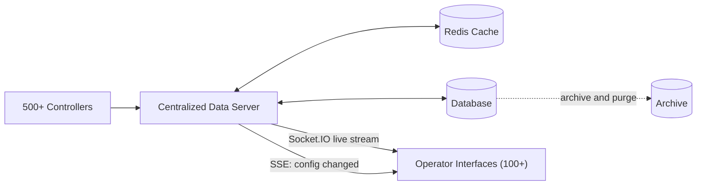
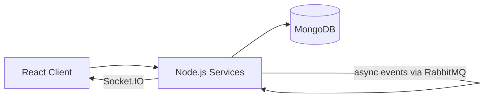

<div align="center">


[](https://git.io/typing-svg)

  

<a href="https://www.linkedin.com/in/binita-dutta"></a>
<a href="mailto:binitadutta777@gmail.com"></a>
<a href="https://leetcode.com/u/BinitaDutta_03/"></a>

</div>

---

## 🧭 The Short Version

Most engineers enjoy shipping features. I enjoy the moment *after*: when a report takes too long, a dashboard lags, or a database starts sweating, and someone has to work out **why**.

For 3.5+ years I've been doing exactly that at **Hamilton Research & Technology (HART)**, building software for **industrial SCADA systems**, where downtime is not an option and "it works on my machine" doesn't count.

```text
┌──────────────────────────────────────────────────────────────┐
│  🧠 Thinks in    →  bottlenecks, hot paths, data flow         │
│  🛠️ Builds with  →  Node.js · TypeScript · Kafka · Redis      │
│  📍 Lives in     →  real-time + high-volume data systems      │
│  🌱 Learning     →  LLMs · RAG · agentic AI                   │
│  🎓 Trained at   →  Asansol Engineering College (CGPA 9.01)   │
└──────────────────────────────────────────────────────────────┘
```

---

## 🩺 Bugs, Bottlenecks & Fixes

A few real problems I've diagnosed at work, and what changed afterwards.

| 🔍 The Problem | 🔧 What I Did | 📈 The Result |
|---|---|---|
| Slow report generation in a monolithic SCADA app | Split it into domain-specific **microservices** with Node.js/Express REST APIs | Report generation time **↓ 90%** |
| Frequent hot reads hammering the database | Introduced **Redis caching** on the hot path | Retrieval latency **↓ ~80%**, DB load **↓ 60%** |
| Operators polling APIs for live process data | Moved the pipeline to **Socket.IO event streaming** | Continuous updates, far fewer redundant requests |
| Operators acting on stale configs across tabs and machines | Built an **SSE-based sync mechanism** that flags stale data | Fewer conflicting or outdated configurations |
| High-volume real-time data eating disk space | Engineered **automated archival + retention cleanup** | Disk utilization **↓ ~30–40%** |
| Fragmented, line-by-line data access | Centralized retrieval for **500+ controllers** across **100+ operator endpoints** into one server | Historical data accessibility **↑ ~40–50%** |

---

## 🗺️ The Kind of System I Work On

A simplified, conceptual view of the architecture behind the table above:



---

## 🍔 Side Quest: Dinezo

A real-time food delivery platform I built to practice event-driven microservices end to end.



- 📨 **RabbitMQ** keeps services decoupled through asynchronous communication
- 📍 **Socket.IO** pushes live order status and rider location to the client
- 🐳 Containerized with **Docker**

[](https://github.com/BinitaDuttaDec03/dinezo)

---

## 🧰 Toolbox

<div align="center">

           

</div>

<details>
<summary><b>See the full list</b></summary>

<br>

| Area | Tools |
|---|---|
| **Languages** | TypeScript, JavaScript (ES6+), Python |
| **Backend** | Node.js, Express.js, REST APIs, JWT, OAuth2.0 |
| **Distributed & Real-Time** | Apache Kafka, RabbitMQ, Redis, Socket.IO, Server-Sent Events, Event-Driven Architecture |
| **Databases** | MongoDB, PostgreSQL, Mongoose, Prisma |
| **Frontend** | React.js, Next.js, Redux, Zustand, Tailwind CSS |
| **Architecture & Tools** | Microservices, System Design, Git, Docker, Postman, Swagger/OpenAPI |

</details>

---

## 🌱 Currently Exploring

- 🤖 **LLMs, RAG, and agentic AI**, and how to fit them into practical, scalable software instead of demos
- 🏗️ Deeper **system design** and **distributed systems** patterns
- ⚙️ **Performance engineering** for real-time, data-intensive workloads

---

## 🏅 Recognition

🌟 **Star Performer of the Month** at HART, for end-to-end project ownership, client management, and delivering maintainable solutions from requirements through production.

---

## 📊 Activity

<div align="center">


</div>

---

## 🤝 Let's Talk

If you're building something **real-time, data-heavy, or just painfully slow**, I'd love to hear about it.

I'm looking for **Backend and Full-Stack Software Engineer** roles with teams working on system design, performance, and distributed systems.

📫 [binitadutta777@gmail.com](mailto:binitadutta777@gmail.com) &nbsp;·&nbsp; 💼 [LinkedIn](https://www.linkedin.com/in/binita-dutta) &nbsp;·&nbsp; 🧩 [LeetCode](https://leetcode.com/u/BinitaDutta_03/)

<div align="center">

[](https://git.io/typing-svg)

</div>
